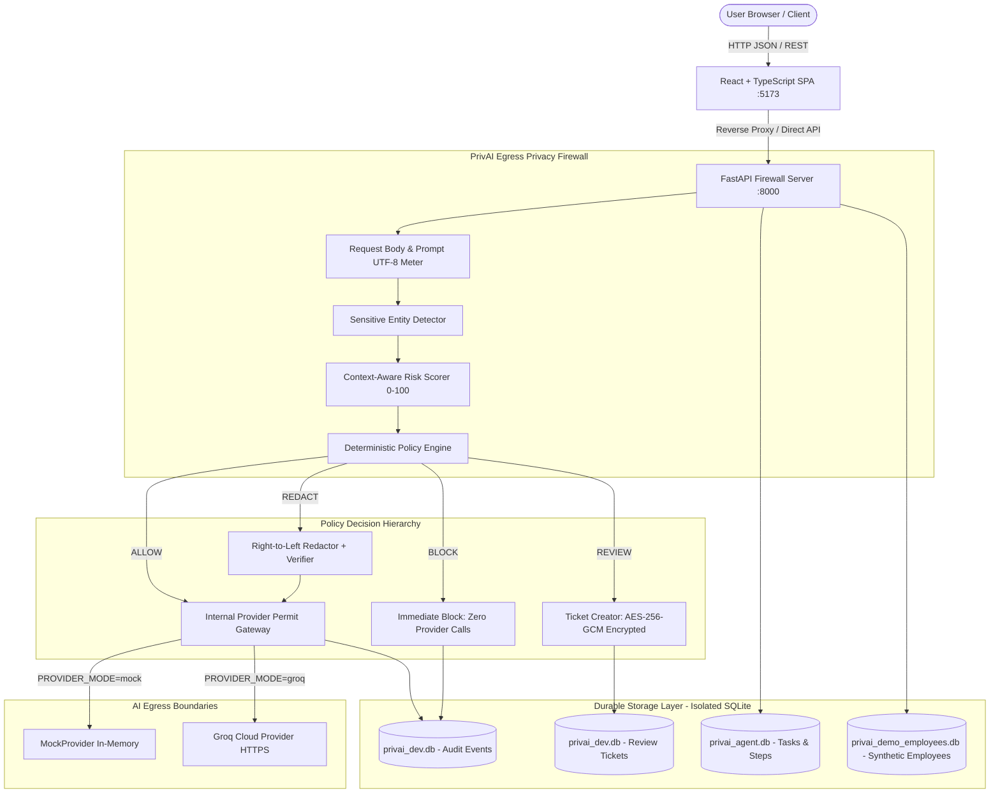

# PrivAI — Secure Task Agent & AI Privacy Firewall

> **An enterprise-grade, egress privacy firewall and bounded task execution platform that detects sensitive entities, calculates explainable multi-factor risk scores, deterministically enforces data governance policies (`ALLOW`, `REDACT`, `BLOCK`, `REVIEW`), sandboxes tool execution, and provides cryptographically verifiable audit logging.**

---

## 1. Project Title & Short Description

**PrivAI — Secure Task Agent** is a context-aware egress privacy firewall and autonomous bounded task execution agent positioned between enterprise applications and Large Language Model (LLM) providers. It provides:
- Real-time detection of sensitive PII, PHI, financial data, and enterprise identifiers.
- Explainable, deterministic multi-factor risk scoring ($S, N, C, D, I$).
- Strict policy enforcement through a four-decision governance ladder (`ALLOW`, `REDACT`, `BLOCK`, `REVIEW`).
- Right-to-left token sanitization with post-redaction residual entity verification.
- Human-in-the-loop review workflow with AES-256-GCM envelope encryption at rest and single-use HMAC-SHA256 review permits.
- Bounded autonomous task planning with server-side tool allowlists and indirect prompt injection quarantine.
- An interactive Employee Privacy Demo showcasing role-based field-level masking on synthetic enterprise personnel records.
- Tamper-evident SHA-256 audit hash-chaining and Merkle tree checkpoint anchoring.

---

## 2. Problem Statement & Motivation

Organizations increasingly adopt AI assistants and autonomous task agents to analyze internal data, summarize documents, and automate repetitive workflows. However, direct egress to cloud LLM providers creates critical security and compliance hazards:
1. **Accidental PII/PHI Exfiltration**: Employees paste customer records, medical notes, or personal financial identifiers into prompts, risking severe GDPR, HIPAA, and CCPA violations.
2. **Autonomous Agent Runaway & Tool Abuse**: Unbounded agents with shell, file, or browser capabilities can be hijacked via indirect prompt injection to execute unauthorized actions, exfiltrate private files, or incur massive costs.
3. **Lack of Verifiable Auditability**: Most AI integrations lack tamper-evident proof of what was inspected, sanitized, or approved before leaving enterprise boundaries.
4. **All-or-Nothing Blocking**: Traditional web proxies block requests entirely, breaking employee productivity, or allow everything without redaction or review.

**PrivAI solves this** by acting as an intelligent, deterministic egress firewall that gates all model dispatches and tool executions through mathematical risk formulas and strict policy rules, enabling safe AI adoption without compromising data privacy.

---

## 3. Key Features

- **Sensitive Entity Detection**: High-performance regex and span-based rules detecting Email Addresses (RFC 5322), Phone Numbers (E.164/NANP), National IDs (SSN), Credit Cards (Luhn verified), and Employee IDs (`EMP-XXXX`).
- **Deterministic Multi-Factor Risk Scoring**: Computes an explainable score $0–100$ decomposing Severity ($S$), Count ($N$), Context ($C$), Destination ($D$), and Identifiability ($I$).
- **Deterministic Governance Policy Ladder**:
  - `ALLOW`: Permitted safe content forwarded under internal single-use permits.
  - `REDACT`: Low/medium risk entities sanitized with deterministic replacement tokens (`[EMAIL]`, `[PHONE]`, `[EMPLOYEE_ID]`) before egress.
  - `BLOCK`: High-risk or restricted content halted with **strictly zero provider calls**.
  - `REVIEW`: Compliance-sensitive content suspended with an encrypted review ticket until approved by an authorized officer.
- **Fail-Closed Sanitization Verification**: Post-redaction rescanning ensures zero residual sensitive entities before model dispatch.
- **Human-in-the-Loop Review Portal**: Reviewers inspect AES-256-GCM encrypted payloads, issue 300-second HMAC-SHA256 review permits, and enforce atomic single-use permit consumption.
- **PrivAI Secure Task Agent**:
  - Accepts natural language goals and synthesizes bounded multi-step plans (capped at 5 steps, 2 retries).
  - Server-side tool allowlist (`read_document`, `search_documents`, `summarize_text`, `format_report`). Prohibits shells, browsers, and network egress.
  - Indirect prompt injection defense quarantining document content in untrusted data envelopes.
- **Employee Privacy Demo**: Interactive directory displaying 15 synthetic employee records, illustrating field-level authorization (salary=BLOCK, health=REVIEW, email=REDACT, name=ALLOW) and isolated database resetting.
- **Cryptographic Audit Ledger**: Pre-transmission audit logging with SHA-256 hash chaining, Merkle tree checkpoints, and optional transparency log anchoring.
- **Anti-Bypass State Invalidation**: Frontend edits immediately invalidate prior analysis and lock execution to prevent TOCTOU bypass attacks.

---

## 4. Architecture Overview & Request Flow



---

## 5. Explanation of ALLOW, REDACT, BLOCK, and REVIEW

| Decision | Criteria & Triggers | Outbound Egress Behavior | Audit & Storage |
| :--- | :--- | :--- | :--- |
| **`ALLOW`** | Zero sensitive findings; risk score $< 30$; safe business context. | The validated prompt is dispatched to the selected AI provider under an internal single-use permit. | Pre-transmission audit event committed with SHA-256 content digest. |
| **`REDACT`** | Low/medium entities detected (`EMAIL_ADDRESS`, `PHONE_NUMBER`, `EMPLOYEE_ID`); classification is not `RESTRICTED`. | **Sanitized text only** is sent to the provider. The `RedactionVerifier` re-scans the text to guarantee zero residual sensitive entities. | Audit records entity counts, offsets, and replacement tokens. Raw sensitive text is omitted. |
| **`BLOCK`** | High-risk entities detected (`NATIONAL_ID`, `CREDIT_CARD`); classification is `RESTRICTED`; or risk score $\ge 70$. | **Strictly ZERO provider calls**. Execution terminates immediately. No network sockets are opened to AI providers. | Audit records rule IDs and risk score. User receives safe error explanation. |
| **`REVIEW`** | Sensitive business domain (`HEALTH_INFORMATION`, `SALARY_DATA`); or risk score $\in [30, 69]$ with `CONFIDENTIAL` classification. | **Strictly ZERO provider calls**. Request suspended; ticket generated. Awaiting human compliance sign-off. | Ticket payload encrypted at rest with AES-256-GCM. Approval mints an HMAC-SHA256 permit (300s TTL). |

---

## 6. Employee Privacy Demo & Synthetic Employee Records

The **Employee Privacy Demo** showcases field-level data governance and privacy preserving workflows on synthetic corporate personnel data:

- **15 Canonical Synthetic Records**: All names, email addresses, phone numbers, employee IDs, salaries, and medical notes are 100% fictional.
- **Field-Level Authorization Matrix**:
  - `salary`, `payroll_id`: Sensitivity `RESTRICTED` $\to$ **`BLOCK`** (Masked: `[RESTRICTED - Unauthorized]`).
  - `health_notes`: Sensitivity `RESTRICTED` $\to$ **`REVIEW`** (Masked: `[RESTRICTED - Compliance Review Required]`).
  - `email`, `phone`: Sensitivity `CONFIDENTIAL` $\to$ **`REDACT`** (Masked: `[REDACTED]`).
  - `name`, `department`, `job_title`: Sensitivity `PUBLIC` $\to$ **`ALLOW`** (Full visibility).
- **Four Canonical Operational Scenarios**:
  1. **Summarize Profile (`EMP-1001`, Elena Rostova)**: ALLOW workflow $\to$ generates public profile summary.
  2. **Contact Report (`EMP-1002`, Marcus Vance)**: REDACT workflow $\to$ generates report replacing email and phone with `[EMAIL]` and `[PHONE]`.
  3. **Payroll Query (`EMP-1009`, Chen Wei)**: BLOCK workflow $\to$ halts immediately; zero tool or provider calls.
  4. **Health Accommodation Summary (`EMP-1003`, Priya Sharma)**: REVIEW workflow $\to$ suspends task, generates review ticket for occupational health sign-off.
- **Database Reset Isolation**: Clicking "Reset Demo Data" clears and reseeds only `privai_demo_employees.db`. It cannot touch audit logs or historical baseline files.

---

## 7. Technology Stack

- **Backend**:
  - Python 3.11+ / 3.12+
  - FastAPI & Starlette (Asynchronous REST API)
  - Uvicorn (ASGI Application Server, `--workers 1`)
  - Pydantic v2 & Pydantic-Settings (Schema validation and settings management)
  - SQLite3 (Isolated thread-safe database storage)
  - PyJWT & Cryptography (JWT tokens and AES-256-GCM envelope encryption)
  - HTTPX (Mocked and live HTTP client)
- **Frontend**:
  - React 19 & TypeScript 5+
  - Vite v8 (Build tool and development server)
  - Vanilla CSS (Tailored cybernetic dark mode theme; zero Tailwind dependencies)
  - Lucide React (Icons)
- **Testing & Verification**:
  - Pytest & Pytest-Asyncio (Backend unit, integration, and security tests)
  - Vitest & `@testing-library/react` (Frontend unit and component tests)
  - JSDOM (Headless DOM environment for frontend testing)

---

## 8. Project Directory Structure

```
PrivAI_GitHub_Submission/
├── backend/
│   ├── app/
│   │   ├── agent/           # Secure Task Agent (models, tools, planner, service, repo)
│   │   ├── api/             # FastAPI routers (prompts, reviews, audit, health, agent)
│   │   ├── audit/           # Audit service, Merkle trees, hash chaining, anchors
│   │   ├── core/            # Cryptography, KMS, permits, security middleware
│   │   ├── detectors/       # Sensitive entity regex patterns and detector
│   │   ├── employees/       # Synthetic Employee Directory API, service, and repo
│   │   ├── models/          # Pydantic v2 domain schemas and request/response models
│   │   ├── orchestrator/    # Central orchestration service and provider gateway
│   │   ├── policy/          # Deterministic policy engine and rule definitions
│   │   ├── providers/       # AI provider adapters (MockProvider, GroqProvider)
│   │   ├── redaction/       # Right-to-left redactor and post-sanitization verifier
│   │   ├── reviews/         # Review ticket repository and lifecycle service
│   │   ├── risk/            # Explainable multi-factor risk scoring formula
│   │   ├── config.py        # Centralized application configuration
│   │   └── main.py          # FastAPI application entrypoint and lifespan validation
│   └── requirements.txt     # Backend specific requirements
├── frontend/
│   ├── public/              # Static icons and assets
│   ├── src/
│   │   ├── components/      # React components (Workbench, EmployeeDemo, ReviewPortal)
│   │   ├── services/        # Frontend API client and endpoints
│   │   ├── types/           # TypeScript API contracts and domain types
│   │   ├── __tests__/       # Vitest component and integration tests
│   │   ├── App.tsx          # Root application component
│   │   └── index.css        # Core cybernetic design system and styling
│   ├── package.json         # Frontend dependencies and npm scripts
│   ├── tsconfig.json        # TypeScript compiler configuration
│   └── vite.config.ts       # Vite configuration with /v1 backend proxy
├── tests/                   # Full backend Pytest test suite (17 test modules, 204 tests)
├── safe_documents/          # Sandboxed test documents for agent read/search tools
├── agent_reports/           # Sandboxed output directory for agent generated reports
├── scripts/                 # Safe setup, verification, and demonstration scripts
│   ├── preflight_checks.py
│   ├── run_staging_ledger.py
│   ├── smoke_test.py
│   ├── smoke_test_groq.py
│   ├── staging_verification.py
│   └── verify_employee_demo.py
├── docs/                    # Comprehensive system documentation
│   ├── ARCHITECTURE.md      # Detailed system architecture and sequence diagrams
│   ├── SECURITY.md          # Security model, invariants, and threat analysis
│   ├── DEMO_GUIDE.md        # Step-by-step demonstration walkthrough
│   ├── TESTING.md           # Automated test commands and verification reports
│   ├── DEPLOYMENT.md        # Local setup and deployment runbook
│   ├── api_contracts.md     # OpenAPI / REST contracts specification
│   ├── audit_checkpoint_anchoring.md # Merkle anchoring specification
│   └── diagrams/            # Mermaid architecture diagram sources
├── .env.example             # Safe environment configuration template
├── .gitignore               # Strict exclusion of databases, keys, venvs, and node_modules
├── pyproject.toml           # Pytest configuration and project metadata
├── requirements.txt         # Root Python dependencies
├── LICENSE                  # MIT Open Source License
└── README.md                # Project documentation
```

---

## 9. Prerequisites

| Software | Required Version | Verification Command |
| :--- | :--- | :--- |
| **Python** | 3.11, 3.12, or 3.13 | `python --version` |
| **Node.js** | 20.x, 22.x, or 24.x | `node --version` |
| **npm** | 10.x or 11.x | `npm --version` |
| **OS** | Windows, Linux, macOS | Windows PowerShell tested |

---

## 10. Step-by-Step Windows PowerShell Setup Instructions

Open **Windows PowerShell** and follow these commands:

```powershell
# 1. Clone or navigate to the repository directory
cd PrivAI_GitHub_Submission

# 2. Create Python virtual environment
python -m venv .venv

# 3. Activate virtual environment
.venv\Scripts\activate

# 4. Install backend dependencies
python -m pip install --upgrade pip
pip install -r requirements.txt

# 5. Install frontend dependencies
cd frontend
cmd /c "npm install"
cd ..

# 6. Copy environment configuration template
Copy-Item .env.example .env
```

---

## 11. Backend Startup Instructions

From the project root with `.venv` activated:
```powershell
python -m uvicorn backend.app.main:app --host 127.0.0.1 --port 8000
```
- The backend API will be live at `http://127.0.0.1:8000`.
- Verify the health check probe:
  ```powershell
  curl http://127.0.0.1:8000/health
  # Response: {"status":"ok","provider_mode":"mock","policy_loaded":true}
  ```

---

## 12. Frontend Startup Instructions

From the `frontend/` directory in a second PowerShell terminal:
```powershell
cd frontend
cmd /c "npm run dev"
```
*(Note: Using `cmd /c` or `npm.cmd` bypasses Windows PowerShell script execution policy restrictions on `npm.ps1`)*

Open **`http://localhost:5173`** in your web browser. The built-in Vite dev proxy automatically routes all `/v1` and `/health` requests to `http://127.0.0.1:8000`.

---

## 13. Environment Variable Configuration

The `.env` file (copied from `.env.example`) controls runtime behavior. Key parameters:

| Variable | Default Value | Description |
| :--- | :--- | :--- |
| `ENVIRONMENT` | `development` | Environment mode (`development`, `staging`, `production`). |
| `PROVIDER_MODE` | `mock` | AI Provider: `mock` (safe offline local) or `groq` (Groq Cloud API). |
| `DATABASE_PATH` | `privai_dev.db` | Dedicated SQLite database for review tickets and audit logs. |
| `AGENT_DATABASE_PATH` | `privai_agent.db` | Dedicated SQLite database for agent tasks and steps. |
| `EMPLOYEE_DEMO_DATABASE_PATH` | `privai_demo_employees.db` | Dedicated SQLite database for synthetic personnel directory. |
| `GROQ_API_KEY` | *(empty)* | Secret API key for Groq Cloud (backend only). |
| `GROQ_MODEL` | `llama-3.1-8b-instant` | Default Groq LLM model identifier. |
| `MAX_BODY_SIZE_BYTES` | `32768` | 32 KiB maximum HTTP request payload limit. |
| `MAX_PROMPT_SIZE_BYTES` | `10240` | 10 KiB maximum UTF-8 prompt character limit. |

---

## 14. Instructions for Running Backend and Frontend Tests

### Backend Tests (Pytest)
Run all backend unit, integration, cryptographic, policy, agent, and security tests:
```powershell
# From project root with .venv activated:
python -m pytest -v
```
**Expected Result**: `202 passed, 2 skipped, 1 warning in ~13.8s` (100% active test pass rate; the 2 skipped tests explicitly verify that historical database `privai_data.db` is omitted per clean-slate security policy).

### Frontend Tests (Vitest)
Run all 36 component, UI, and state invalidation tests:
```powershell
# From frontend/ directory:
cd frontend
cmd /c "npm test -- --no-file-parallelism"
cd ..
```
*(Note: `--no-file-parallelism` executes test files sequentially, minimizing Node.js memory footprint on constrained development machines).*  
**Expected Result**: `7 test files passed, 36 passed in ~14.5s` (100% pass rate).

---

## 15. Instructions for Building the Production Frontend

Compile TypeScript code and package Vite assets into an optimized production bundle:
```powershell
cd frontend
cmd /c "npm run build"
cd ..
```
**Output**: Static files are generated in `frontend/dist/`.  
When `frontend/dist/` exists, FastAPI automatically mounts it at `/` on server startup, enabling unified single-origin deployment on `http://127.0.0.1:8000`.

---

## 16. Safe Demonstration Instructions (Synthetic Data & Mock Mode)

1. Launch both backend and frontend as described above.
2. Open `http://localhost:5173` in your browser.
3. Verify top navigation status indicates: `Firewall Active (mock)` and `Policy: policy-v1 (Loaded)`.
4. Run the four core prompt scenarios using the built-in presets:
   - **Safe General (ALLOW)** $\to$ Risk score: 0 $\to$ Direct provider execution authorized.
   - **Customer Email (REDACT)** $\to$ Tokenized as `[EMAIL]` $\to$ Verified sanitized prompt executed.
   - **Confidential SSN (BLOCK)** $\to$ Blocked immediately $\to$ Zero provider calls made.
   - **Patient Record (REVIEW)** $\to$ Held in pending status $\to$ Inspect and approve in Review Portal.
5. Test Anti-Bypass: Click "Analyze Prompt", then type a space in the prompt textarea. Notice the analysis instantly displays an amber warning and disables the "Execute Prompt" button until re-analyzed.
6. Open **"Agent Workbench"**: Run the preset task *"Read reference company policy company_policy.txt and format summary report"* to watch multi-step planning and sandboxed tool execution.
7. Open **"Employee Privacy Demo"**: Inspect role-based field masking on synthetic employees and run the 4 operational scenarios.
8. Run automated demo verification script:
   ```powershell
   python scripts/verify_employee_demo.py
   ```

---

## 17. Screenshots & UI Locations

UI components and screenshots can be visually captured from the running application:
- **Prompt Firewall Workbench**: `http://localhost:5173/` (Editor, Byte Meter, Risk Gauge, Findings, and Redaction Preview).
- **Compliance Review Portal**: `http://localhost:5173/` $\to$ Review Portal tab (Encrypted ticket table, payload decryption inspector, approval dialog).
- **Secure Task Agent Workbench**: `http://localhost:5173/` $\to$ Agent Workbench tab (Goal input, plan graph, sandboxed tool cards, audit reference hashes).
- **Employee Privacy Demo**: `http://localhost:5173/` $\to$ Employee Privacy Demo tab (Synthetic directory, classification filters, field authorization inspector).

---

## 18. Known Limitations & Future Improvements

1. **SQLite Single-Worker Concurrency**: In SQLite deployments, Uvicorn must run with `--workers 1`. Clustered multi-process deployments require PostgreSQL for row-level locks.
2. **KMS & Audit Ledger Qualification**: Staging qualification uses local in-memory KMS keys and a local HTTP ledger sidecar emulator (`scripts/run_staging_ledger.py`). Clustered HashiCorp Vault clusters and hardware immutable WORM ledgers remain unverified in this repository.
3. **Agent Tool Extensibility**: Tools are restricted to 4 sandboxed operations. Future work includes user-definable OpenAPI tool manifests with per-tool policy annotations.
4. **Context Length**: Request body size is limited to 32 KiB and prompt text to 10 KiB for resource exhaustion defense.

---

## 19. Security Considerations & Responsible-Use Notes

- **Data Minimization**: Raw sensitive entity values are never written to audit databases, server logs, or error responses.
- **Fail-Closed Guarantee**: Any database write failure, detector exception, or policy configuration error immediately halts execution with HTTP 503; model dispatches are barred.
- **Indirect Prompt Injection**: Document contents are treated as untrusted data envelopes. Injected instructions cannot override system policy engines or execute unapproved tools.
- **Anti-Replay Review Permits**: Cryptographic HMAC-SHA256 permits have a strict 300-second TTL and are atomically invalidated upon consumption.
- **Clean Submission Verification**: This repository contains strictly zero real API keys, credentials, local virtual environments, or persistent databases.

---

## 20. External LLM & Infrastructure Qualification Acknowledgement

- **AI Provider Default**: `PROVIDER_MODE=mock` is the safe, verified offline default. Live Groq Cloud dispatch is fully implemented in `backend/app/providers/groq.py` but requires user opt-in (`PROVIDER_MODE=groq`) and a valid `GROQ_API_KEY`.
- **Infrastructure Disclaimer**: Enterprise Tier 3 infrastructure (live distributed HashiCorp Vault clusters and hardware immutable WORM transparency logs) remains unverified unless subsequently tested in an active enterprise deployment.

---

## License

This project is licensed under the **MIT License** — see the [LICENSE](LICENSE) file for details.
