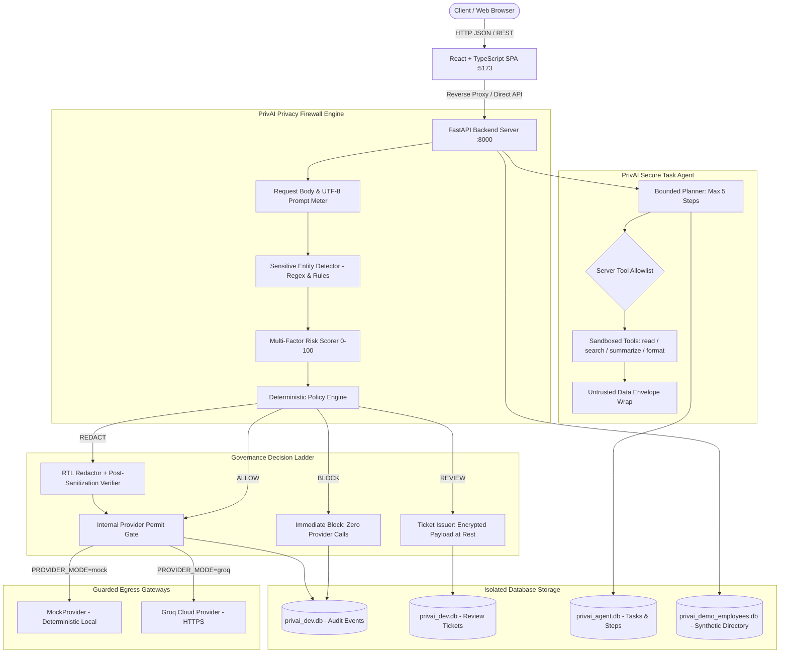
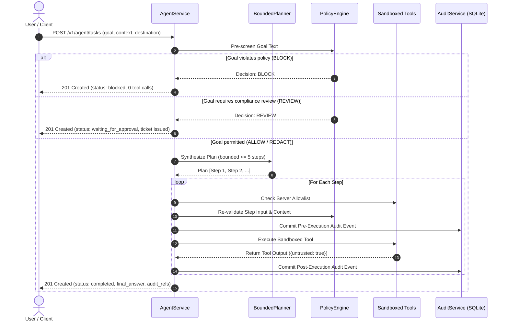
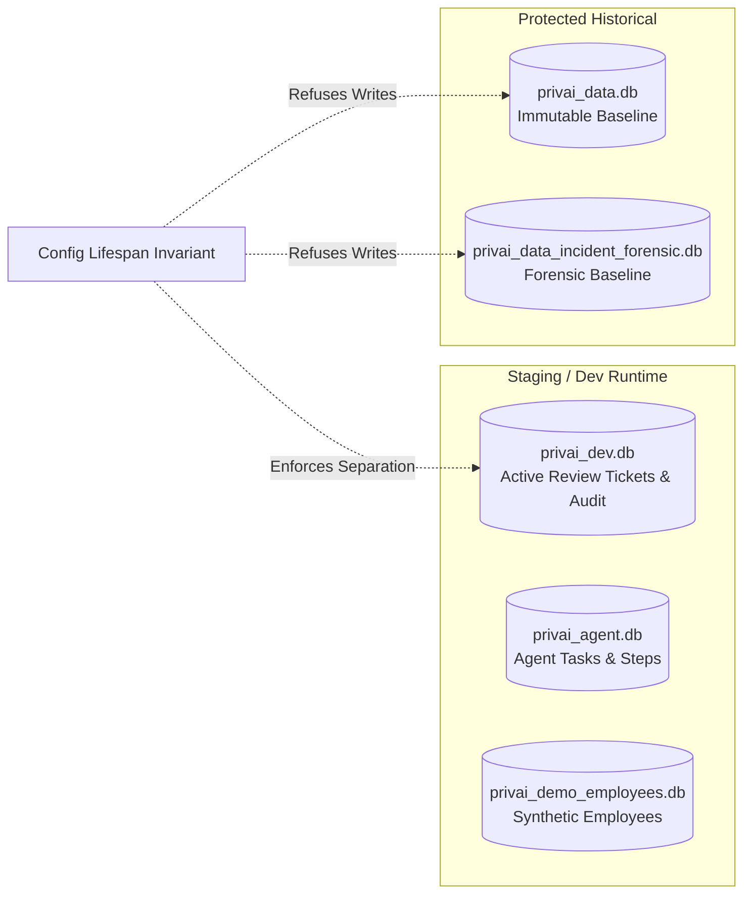

# PrivAI — Technical Architecture & System Design

**Document Version**: 1.0.0  
**Implementation Baseline**: PrivAI Secure Task Agent & Egress Privacy Firewall  
**Audience**: Hackathon Evaluators, Security Engineers, and System Architects

---

## 1. System Overview

**PrivAI** is an enterprise-grade egress privacy firewall and bounded task execution platform positioned between user-facing AI applications and Large Language Model (LLM) providers. It prevents data leaks, enforces organization data governance policies, calculates explainable multi-factor risk scores, santitizes sensitive entities, gates AI model dispatches, orchestrates bounded multi-step agent tasks, and provides cryptographically verifiable audit logs.



---

## 2. Core System Components

### 2.1 React + TypeScript Frontend (`frontend/`)
- **Technology Stack**: React 19, TypeScript, Vite v8, Vanilla CSS (zero Tailwind dependencies), Lucide React icons.
- **Components**:
  - `PromptEditor.tsx`: Prompt authoring with real-time UTF-8 byte meter, demonstration presets, and context configuration (Purpose, Data Subject, Classification).
  - `AnalysisPanel.tsx`: Displays explainable risk score (0–100), factor decomposition ($S, N, C, D, I$), and detected entity findings without leaking raw sensitive text.
  - `RedactionPreview.tsx`: Real-time preview of verified sanitized text and token replacements.
  - `ResponsePanel.tsx`: Displays AI provider outputs, latency metrics, cryptographic audit references, and blocked/review statuses.
  - `ReviewPortal.tsx`: Human-in-the-loop compliance review portal for inspecting encrypted tickets, submitting approvals/rejections, and acquiring single-use permits.
  - `AgentWorkbench.tsx`: Goal input, plan generation visualization, step-by-step policy checks, sandboxed tool outputs, and execution suspension handling.
  - `EmployeePrivacyDemo.tsx`: Interactive privacy showcase demonstrating role-based field masking, department filtering, and the 4 canonical operational workflows (`ALLOW`, `REDACT`, `BLOCK`, `REVIEW`) on synthetic personnel records.
- **Anti-Bypass Invariant**: Editing any character in the prompt or context immediately invalidates prior analysis results and disables execution until re-analyzed.

### 2.2 FastAPI Backend Application (`backend/app/`)
- **Web Framework**: FastAPI with Uvicorn ASGI server.
- **Operational Constraint**: Single-worker concurrency (`--workers 1`) is strictly enforced when running SQLite storage to prevent multi-process database locking race conditions.
- **Security Middleware**:
  - `enforce_body_size_limit`: Rejects HTTP request bodies exceeding `MAX_BODY_SIZE_BYTES` (32 KiB) before allocating memory.
  - `UTF-8 Prompt Length Check`: Rejects prompts exceeding `MAX_PROMPT_SIZE_BYTES` (10 KiB).
  - `verify_team_access`: Optional passkey authentication middleware (`x-privai-team-key`) when sharing demo instances.
  - `SafeErrorMiddleware`: Formats all unhandled exceptions into normalized `SafeErrorResponse` envelopes, stripping stack traces, raw prompts, and credentials.

### 2.3 Sensitive Entity Detector (`backend/app/detectors/`)
- **Engine**: `SensitiveDetector` performs deterministic regex and rule-based pattern matching.
- **Supported Entity Classes**:
  - `EMAIL_ADDRESS`: RFC 5322 compliant email detection.
  - `PHONE_NUMBER`: E.164 and NANP phone numbers.
  - `NATIONAL_ID`: US Social Security Numbers (`\b\d{3}-\d{2}-\d{4}\b`).
  - `CREDIT_CARD`: Major credit card formats validated with Luhn algorithm.
  - `EMPLOYEE_ID`: Enterprise identifier pattern `\bEMP-[0-9]{4,8}\b`.
- **Data Minimization**: Finding records store entity type, span offsets, and confidence score; raw sensitive substring values are never logged or persisted.

### 2.4 Context-Aware Risk Scorer (`backend/app/risk/scorer.py`)
- **Formula**:
  $$\text{RiskScore} = \text{round}\left(100 \times (0.30 \cdot S + 0.10 \cdot N + 0.25 \cdot C + 0.20 \cdot D + 0.15 \cdot I)\right)$$
- **Factor Definitions**:
  - **Severity ($S$)**: Maximum severity weight of detected findings (Critical=1.0, High=0.75, Medium=0.50, Low=0.25).
  - **Count ($N$)**: Normalized count of findings: $\min(1.0, \frac{\text{count}}{5})$.
  - **Context ($C$)**: Multiplier based on declared business purpose, data subject, and classification.
  - **Destination ($D$)**: Egress exposure weight (`mock`=0.0, `groq`=0.8).
  - **Identifiability ($I$)**: Linkage potential derived from distinct sensitive entity categories present.
- **Risk Bands**: Low (`0–29`), Medium (`30–69`), High (`70–100`).

### 2.5 Deterministic Policy Engine (`backend/app/policy/engine.py`)
Enforces a non-negotiable decision hierarchy:
1. **Validation & Fail-Closed**: Schema violations or missing context trigger immediate halt.
2. **Mandatory BLOCK**:
   - `NATIONAL_ID` or `CREDIT_CARD` detected.
   - Classification is `RESTRICTED`.
   - Risk score $\ge 70$.
3. **Compliance REVIEW**:
   - Declared purpose is `HEALTH_INFORMATION` or `SALARY_DATA`.
   - Risk score $\in [30, 69]$ with `CONFIDENTIAL` classification.
4. **Sanitization REDACT**:
   - Low or medium entities detected (`EMAIL_ADDRESS`, `PHONE_NUMBER`, `EMPLOYEE_ID`).
   - Replaced right-to-left with deterministic tokens (`[EMAIL]`, `[PHONE]`, `[EMPLOYEE_ID]`).
   - Must pass `RedactionVerifier` check ensuring zero residual sensitive entities.
5. **Baseline ALLOW**:
   - Zero sensitive findings detected and risk score $< 30$.
6. **Default Catch-All**: Fails closed to `BLOCK`.

---

## 3. PrivAI Secure Task Agent Architecture

The **Secure Task Agent** (`backend/app/agent/`) extends the firewall to autonomous, bounded multi-step operations:



### 3.1 Bounded Planning (`backend/app/agent/planner.py`)
- **Step Limits**: Enforces `AGENT_MAX_STEPS = 5` and `AGENT_MAX_RETRIES = 2`.
- **Execution Timeout**: Enforces `AGENT_TIMEOUT_SECONDS = 30.0`.
- **Goal Pre-Screening**: Evaluates the high-level goal with the Policy Engine before generating any plan steps.

### 3.2 Server-Side Tool Allowlist (`backend/app/agent/tools.py`)
Only 4 sandboxed tools are permitted:
1. `read_document`: Reads text files strictly from `safe_documents/`. Rejects path traversal (`..`, `/`, `\`).
2. `search_documents`: Bounded keyword search strictly within `safe_documents/`.
3. `summarize_text`: Bounded extractive text summarization preserving sanitized placeholders.
4. `format_report`: Writes sanitized markdown reports strictly into `agent_reports/`.

**Strictly Prohibited System Capabilities**:
Arbitrary shell execution (`bash`, `sh`, `cmd`, `powershell`), arbitrary filesystem access, raw outbound socket network access, browser automation, email sending, payment execution, and database schema mutations are hard-rejected at the schema level.

### 3.3 Indirect Prompt Injection Quarantine
All content returned from documents or external inputs is tagged with an **untrusted data envelope**:
```json
{
  "document_id": "company_policy.txt",
  "content": "[document text]",
  "untrusted": true
}
```
Tool selection is enforced strictly in Python server-side allowlists; text instructions inside documents cannot execute forbidden tools or alter system policies.

---

## 4. Synthetic Employee Directory Architecture

The Employee Privacy Demo (`backend/app/employees/`) showcases field-level data governance on synthetic enterprise data:

- **Isolated Storage**: Operates on `privai_demo_employees.db`, completely isolated from core audit logs.
- **Deterministic Seeding**: Automatically seeds 15 canonical synthetic personnel records on first startup. All names, emails, phones, IDs, salaries, and health records are 100% fictional.
- **Field Authorization Matrix**:
  - `salary`, `payroll_id`: Sensitivity `RESTRICTED` $\to$ Governed as `BLOCK` (Masked: `[RESTRICTED - Unauthorized]`).
  - `health_notes`: Sensitivity `RESTRICTED` $\to$ Governed as `REVIEW` (Masked: `[RESTRICTED - Compliance Review Required]`).
  - `email`, `phone`: Sensitivity `CONFIDENTIAL` $\to$ Governed as `REDACT` (Masked: `[REDACTED]`).
  - `name`, `department`, `job_title`: Sensitivity `PUBLIC` $\to$ Governed as `ALLOW` (Full visibility).
- **Reset Invariant**: Resetting demo data drops and reseeds only `demo_employees` table; it can never touch or modify other databases.

---

## 5. Storage & Database Isolation Invariants



1. **Self-Bootstrapping**: All runtime databases (`privai_dev.db`, `privai_agent.db`, `privai_demo_employees.db`) automatically initialize tables and schemas on first startup. Pre-existing database files are not required.
2. **Historical Protection**: `settings.validate_runtime_database_isolation()` executes during application startup lifespan. If `DATABASE_PATH` or `EMPLOYEE_DEMO_DATABASE_PATH` points to `privai_data.db` or forensic databases in development/staging, the server refuses to start with a `RuntimeError`.
3. **Fail-Closed Audit Durability**: Pre-transmission audit logging writes events to SQLite before provider dispatch. If the write fails, execution aborts with HTTP 503 fail-closed.
